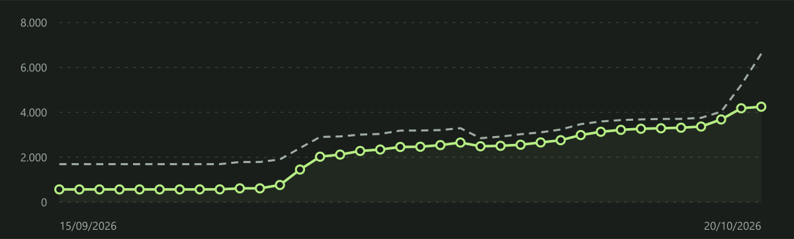

# AnyPS5 Tracker

Monitor independente do desenvolvimento do **[AnyPS5](https://github.com/boykopovar/AnyPS5)**, com painel para Windows e aplicativo Android. Criado por **[@Izamaru](https://github.com/Izamaru)** para acompanhar métricas públicas, com atenção às tecnologias usadas por **Ghost of Yōtei**.

**O mérito do AnyPS5, de suas implementações e das métricas oficiais pertence a [@boykopovar](https://github.com/boykopovar) e aos [contribuidores do projeto original](https://github.com/boykopovar/AnyPS5/graphs/contributors).** O Tracker organiza e apresenta essas informações. Este repositório não é afiliado nem uma distribuição oficial do AnyPS5.

## O que o painel mostra

- Quantidade de funções de bibliotecas PS5 implementadas, declaradas e pendentes.
- Gráfico diário quantitativo: implementadas em linha contínua e declaradas em linha tracejada, com escala automática.
- Comparação com o dia anterior, priorizando o histórico oficial.
- Instruções de GPU reconhecidas, bibliotecas pesquisáveis, releases e commits relevantes.
- Intervalos de recarga de 5, 15 e 30 minutos, 1, 2, 3 e 6 horas, com preferência salva.
- Últimos dados disponíveis offline e identificação das fontes.



*Imagem ilustrativa de uma coleta. Os números mudam conforme o desenvolvimento do AnyPS5.*

## Windows

Requer **Python 3.10 ou superior**. Depois de baixar ou clonar o repositório:

1. Abra a pasta `AnyPS5-Tracker`.
2. Execute `INICIAR.bat` para coletar os dados e abrir o painel.
3. Para coletar automaticamente a cada 5 minutos, execute `INSTALAR-BOT-5MIN.bat` uma vez.
4. Para remover o agendamento, execute `REMOVER-BOT.bat`.

A coleta automática depende do PC ligado, com internet e com sua sessão do Windows conectada. A recarga do painel e a coleta são independentes: o seletor da página controla quando ela é recarregada; o Agendador do Windows controla quando os dados são consultados.

[Guia completo do Tracker para PC](AnyPS5-Tracker/README.md).

## Android

A versão Android atual é **0.2.1**, para **Android 8.0+**, com Android System WebView atualizado. O app consulta as fontes diretamente no celular e funciona com o PC desligado.

**[Baixar o APK v0.2.1 e conferir o SHA-256](https://github.com/Izamaru/AnyPS5-Tracker/releases/tag/v0.2.1).**

Atualiza ao abrir e enquanto estiver em uso. A última leitura é salva para consulta offline. Não executa consultas periódicas com o app fechado e não exige conta ou login.

O código está em [`android/`](android/README.md). As ferramentas pesadas, arquivos de compilação e chaves de assinatura ficam fora do controle de versão. Os APKs de compilação local são gerados em `AnyPS5-Tracker/releases/`.

## Fontes e créditos

| Fonte | Uso no Tracker |
| --- | --- |
| [AnyPS5 — @boykopovar e contribuidores](https://github.com/boykopovar/AnyPS5) | Projeto acompanhado; informações de releases e commits públicos. |
| [Progresso oficial](https://boykopovar.github.io/AnyPS5/progress.html) / [progress.json](https://boykopovar.github.io/AnyPS5/progress.json) | Contagens de bibliotecas e instruções da GPU. |
| [Histórico oficial](https://boykopovar.github.io/AnyPS5/history.html) / [history.json](https://boykopovar.github.io/AnyPS5/history.json) | Série diária e referência para comparar com ontem. |
| [Discussão de Ghost of Yōtei](https://github.com/boykopovar/AnyPS5/discussions/675) | Acompanhamento público do jogo, aberto como link de referência. |

Os registros oficiais podem ser recalculados pelos mantenedores com regras de contagem atualizadas. O Tracker preserva os valores publicados e distingue dados oficiais de medições locais. Veja os detalhes em [CREDITS.md](CREDITS.md).

## Limites das métricas

Os percentuais representam cobertura das funções e instruções listadas pelo projeto, não a porcentagem de jogos compatíveis. Reconhecer instruções ou contabilizar funções não confirma que Ghost of Yōtei inicia, renderiza corretamente ou está jogável no PC.

O Tracker não contém jogos, firmware, bibliotecas proprietárias, chaves de consoles ou código-fonte do AnyPS5. Links e dados externos permanecem sujeitos às condições de suas fontes.

## Estrutura

```text
AnyPS5-Tracker/        Coletor Python, painel HTML e agendamento para Windows
  tests/              Testes Python e JavaScript, incluindo os testes móveis
android/              Aplicativo e scripts de compilação Android
docs/                 Imagens e documentação pública
CREDITS.md            Fontes e atribuições
LICENSE               Licença MIT do código original do Tracker
```

## Desenvolvimento e testes

Na raiz do repositório, com Python 3.10+ e Node.js:

```powershell
python -m unittest discover -s AnyPS5-Tracker/tests -v
node AnyPS5-Tracker/tests/test_dashboard_ui.js
python android/prepare_assets.py
node AnyPS5-Tracker/tests/test_android_mobile.js
```

Os testes usam dados artificiais, sem consultar serviços externos. Para compilar o APK, siga o [guia Android](android/README.md).

## Licença

O código original deste Tracker é distribuído sob a **[licença MIT](LICENSE)**, com atribuição a Izamaru e aos contribuidores.

O **AnyPS5 é um projeto separado**, que informa a licença **[GPL-2.0-only](https://github.com/boykopovar/AnyPS5/blob/main/LICENSE)**. A licença MIT deste repositório não substitui a licença do AnyPS5, dos seus componentes, das ferramentas de compilação ou de outras fontes externas.
